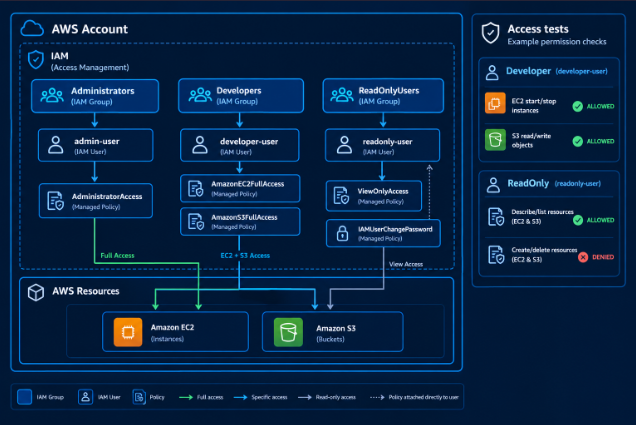
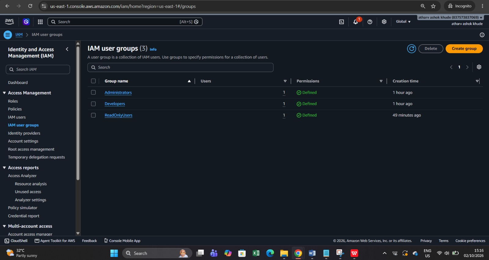
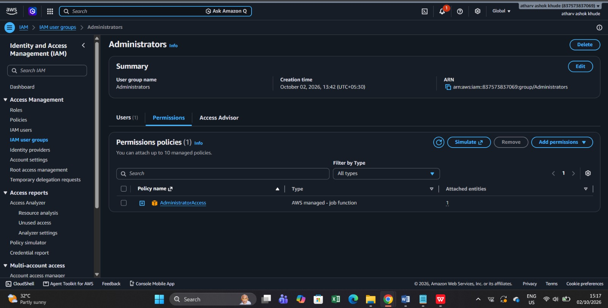
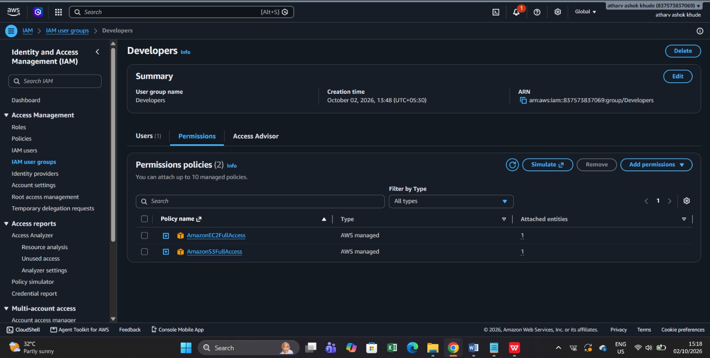
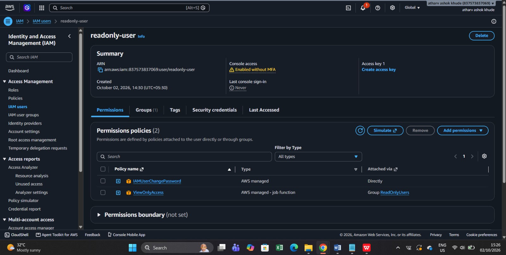
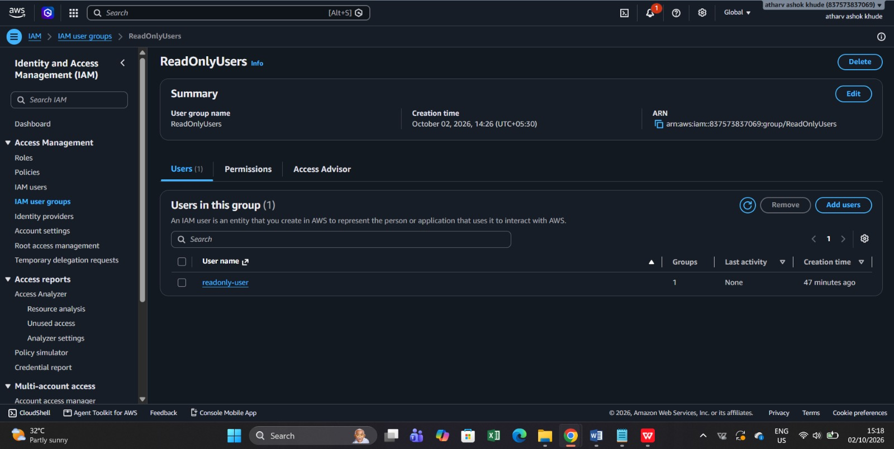
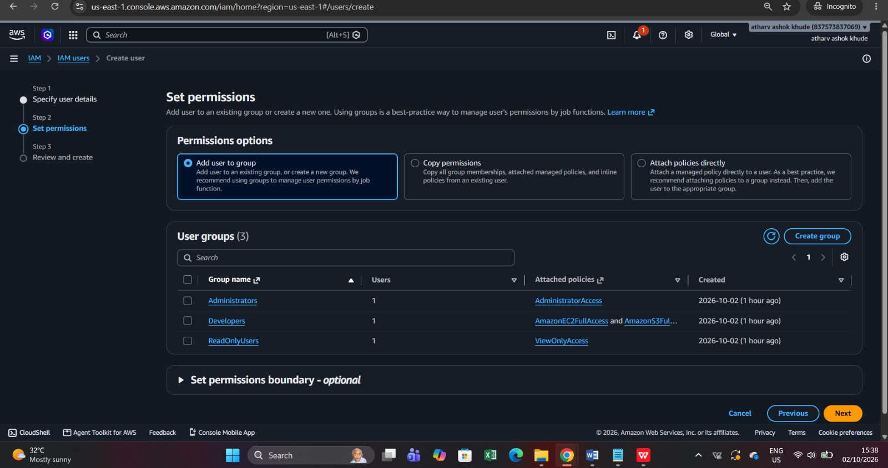
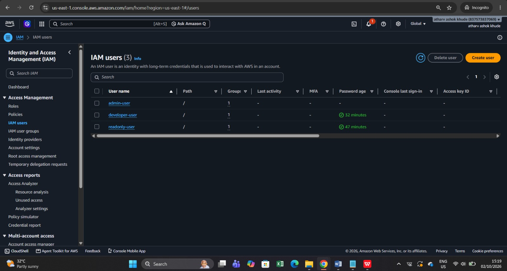
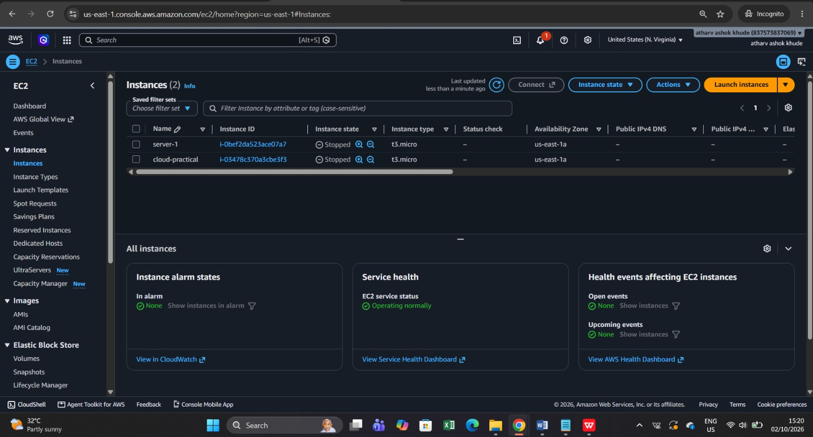

# AWS IAM-Based Access Management Environment

## Project Title

**AWS IAM Based Access Management Environment for an Organisation**

## Objective

The objective of this project is to create an AWS IAM access-management
environment with separate users and groups for:

1.  **Administrators**
2.  **Developers**
3.  **Read-only users**

Appropriate AWS managed policies are attached to each group so that
users receive permissions according to their job role. The project also
demonstrates the difference between permitted and denied AWS operations.

------------------------------------------------------------------------

# 1. Architecture



### Architecture flow

``` text
                         AWS ACCOUNT
                              |
                             IAM
                              |
        +---------------------+----------------------+
        |                     |                      |
 Administrators           Developers          ReadOnlyUsers
        |                     |                      |
   admin-user          developer-user          readonly-user
        |                     |                      |
 AdministratorAccess   EC2FullAccess           ViewOnlyAccess
                       S3FullAccess             + Password Change
        |                     |                      |
        +---------------------+----------------------+
                              |
                     AWS Resources
                       /           \
                     EC2           S3
```

------------------------------------------------------------------------

# 2. Create IAM User Groups

Three IAM groups were created according to organisational roles:

-   `Administrators`
-   `Developers`
-   `ReadOnlyUsers`

Each group receives policies appropriate to its role.

## Step 2.1 -- IAM User Groups List

The AWS IAM console shows all three groups.



**Result:** Three groups are available:

-   Administrators
-   Developers
-   ReadOnlyUsers

------------------------------------------------------------------------

# 3. Configure the Administrators Group

The `Administrators` group is intended for users who require broad AWS
administration.

## Step 3.1 -- Administrator Policy

The `AdministratorAccess` AWS managed policy is attached to the group.



**Policy attached:**

`AdministratorAccess`

**Purpose:** Provides broad access to AWS services and resources,
subject to any other account-level restrictions.

------------------------------------------------------------------------

# 4. Configure the Developers Group

The `Developers` group is intended for users who work with EC2 and S3.

## Step 4.1 -- Developer Policies

Two AWS managed policies are attached:

-   `AmazonEC2FullAccess`
-   `AmazonS3FullAccess`



**Purpose:**

-   EC2 management
-   S3 bucket and object management
-   Start/stop and other EC2 operations covered by the policy
-   S3 read/write operations covered by the policy

------------------------------------------------------------------------

# 5. Configure the ReadOnlyUsers Group

The `ReadOnlyUsers` group is intended for users who need to view AWS
resources without changing them.

## Step 5.1 -- ReadOnlyUsers Group

The group contains the `readonly-user`.



## Step 5.2 -- Read-only Policy

The `ViewOnlyAccess` policy is attached through the group.

The user also has `IAMUserChangePassword` attached directly, allowing
the user to change their own IAM console password.



**Purpose:**

-   View/describe AWS resources where permitted by `ViewOnlyAccess`
-   No normal create/update/delete permissions through `ViewOnlyAccess`
-   Self password change through `IAMUserChangePassword`

------------------------------------------------------------------------

# 6. Create and Assign IAM Users

The environment contains one user for each organisational role.

  ------------------------------------------------------------------------
  Group                   IAM User                Main Policy
  ----------------------- ----------------------- ------------------------
  Administrators          `admin-user`            `AdministratorAccess`

  Developers              `developer-user`        `AmazonEC2FullAccess`,
                                                  `AmazonS3FullAccess`

  ReadOnlyUsers           `readonly-user`         `ViewOnlyAccess`
  ------------------------------------------------------------------------

## Step 6.1 -- IAM User Creation / Permission Assignment

The AWS IAM user creation page shows the option to add the user to an
existing group.



This demonstrates assigning a user to the appropriate job-function group
rather than managing all permissions individually.

## Step 6.2 -- IAM Users List

The IAM console shows the three users.



**Users created:**

-   `admin-user`
-   `developer-user`
-   `readonly-user`

Each user belongs to one IAM group.

------------------------------------------------------------------------

# 7. AWS EC2 Resources

The project uses Amazon EC2 as one of the AWS resources on which
permissions can be demonstrated.

## Step 7.1 -- EC2 Instances

The EC2 console contains two instances shown in the supplied evidence.



The instances shown are:

-   `server-1`
-   `cloud-practical`

Their state in the supplied screenshot is **Stopped**.

------------------------------------------------------------------------

# 8. Access Permission Demonstration

The main purpose of the IAM environment is to demonstrate different
permission levels.

## 8.1 Administrator

`admin-user` belongs to the `Administrators` group.

### Expected access

  Operation                  Result
  -------------------------- ---------
  View EC2                   Allowed
  Start/stop EC2             Allowed
  Create/modify EC2          Allowed
  View S3                    Allowed
  Upload/delete S3 objects   Allowed
  Create/delete S3 bucket    Allowed
  IAM administration         Allowed

The exact result can still be restricted by account-level controls such
as SCPs, permissions boundaries, resource policies, or explicit denies.

------------------------------------------------------------------------

## 8.2 Developer

`developer-user` belongs to the `Developers` group.

Policies:

-   `AmazonEC2FullAccess`
-   `AmazonS3FullAccess`

### Expected access

  Operation                    Result
  ---------------------------- -----------------------------------
  View EC2                     **Allowed**
  Start/stop EC2               **Allowed**
  Create/modify EC2            **Allowed**
  View S3                      **Allowed**
  Upload/delete S3 objects     **Allowed**
  Create/delete S3 bucket      **Allowed**
  General IAM administration   **Not granted by these policies**

------------------------------------------------------------------------

## 8.3 Read-only User

`readonly-user` belongs to the `ReadOnlyUsers` group.

Policy:

-   `ViewOnlyAccess`

Additional direct policy:

-   `IAMUserChangePassword`

### Expected access

  Operation                  Result
  -------------------------- ---------------------------------------------
  View EC2                   **Allowed**
  View S3                    **Allowed** where covered by the policy
  Start/stop EC2             **Denied**
  Create/modify EC2          **Denied**
  Upload/delete S3 objects   **Denied**
  Create/delete S3 bucket    **Denied**
  Change own password        **Allowed** through `IAMUserChangePassword`

------------------------------------------------------------------------

# 9. How to Demonstrate Allowed and Denied Operations

## Test A -- Developer

1.  Sign in as `developer-user`.
2.  Open **EC2 → Instances**.
3.  Select an EC2 instance.
4.  Try a permitted operation such as **Start** or **Stop**.
5.  Open S3.
6.  Test an S3 read/write operation.

The developer policies are intended to permit EC2 and S3 management
operations covered by those policies.

## Test B -- Read-only User

1.  Sign in as `readonly-user`.
2.  Open **EC2 → Instances**.
3.  Confirm that instances can be viewed.
4.  Attempt to start or stop an instance.
5.  Open S3.
6.  Attempt an operation that changes a resource, such as uploading or
    deleting an object.

The read-only user should receive an **Access Denied** result for
operations not granted by the attached policies.

## Test C -- Administrator

1.  Sign in as `admin-user`.
2.  Open EC2 and S3.
3.  Perform the same operations.
4.  The administrator policy provides broad permissions, subject to
    other AWS authorization controls.

> **Evidence note:** The supplied screenshots document the IAM
> configuration and EC2 resources. They do not visibly show an
> `AccessDenied` error screen, so the denied results above are described
> as the expected policy outcome rather than claimed as screenshot
> evidence.

------------------------------------------------------------------------

# 10. Permission Comparison

  --------------------------------------------------------------------------------
  Capability            Administrator          Developer                 Read-only
  ---------------- ------------------ ------------------ -------------------------
  View EC2                    Allowed            Allowed                   Allowed

  Manage EC2                  Allowed            Allowed                    Denied

  View S3                     Allowed            Allowed                   Allowed

  Manage S3                   Allowed            Allowed                    Denied

  IAM                    Broad access     Not granted by               Not granted
  administration                          shown policies 

  Change own            Possible with         Depends on               Allowed via
  password            appropriate IAM           attached   `IAMUserChangePassword`
                          permissions        permissions 
  --------------------------------------------------------------------------------

------------------------------------------------------------------------

# 11. Evidence / Screenshots Summary

  Process                           Screenshot
  --------------------------------- ------------------------
  IAM user permission assignment    `aws-screenshot-1.jpg`
  Read-only user permissions        `aws-screenshot-2.jpg`
  EC2 instances                     `aws-screenshot-3.jpg`
  IAM users list                    `aws-screenshot-4.jpg`
  ReadOnlyUsers group               `aws-screenshot-5.jpg`
  Developers group and policies     `aws-screenshot-6.jpg`
  Administrators group and policy   `aws-screenshot-7.jpg`
  IAM user groups list              `aws-screenshot-8.jpg`

All screenshots are placed directly under the relevant process above.

------------------------------------------------------------------------

# 12. Security Best Practices

-   Use IAM groups to manage permissions according to job roles.
-   Follow the **principle of least privilege**.
-   Enable MFA for human users, particularly administrators.
-   Avoid using the AWS root user for normal operations.
-   Prefer IAM roles for AWS workloads where possible.
-   Remove unused users and credentials.
-   Review permissions regularly.
-   Monitor activity using AWS logging and auditing services such as
    CloudTrail.
-   Avoid unnecessary long-lived access keys.

------------------------------------------------------------------------

# 13. Final Result

The completed IAM environment provides three distinct access levels:

``` text
Administrator
     |
     |-- Full AWS administration
     |
Developer
     |
     |-- EC2 + S3 management
     |
Read-only
     |
     |-- View resources
     |-- No normal resource modification
```

This demonstrates how AWS IAM can separate access according to
organisational responsibilities and reduce unnecessary permissions.

------------------------------------------------------------------------

## Project Files

``` text
aws-iam-access-management/
│
├── README.md
├── architecture.png
│
└── screenshots/
    ├── Admin-Policies.jpeg
    ├── Architecture.jpeg
    ├── Dev-policies.jpeg
    ├── IAM-Groups.jpeg
    ├── IAM-Users.jpeg
    ├── Instances.jpeg
    ├── ReadOnly-User.jpeg
    └── ReadOnly-Policies.jpeg
    └── Set-Permission.jpeg
    
```
